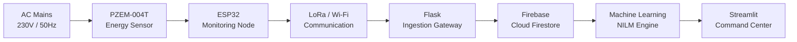

<div align="center">

# ⚡ AI-Enabled Smart Electricity Monitoring and Energy Analytics System

### *IoT-Based Non-Intrusive Load Monitoring, Appliance Recognition, Power Quality Analysis and Energy Optimization*


<br/>


**Designed and implemented by MADHAVA D KAMATH**

</div>

---

## 📖 Table of Contents

- [About the Project](#-about-the-project)
- [Project Objectives](#-project-objectives)
- [What is NILM?](#-what-is-nilm-non-intrusive-load-monitoring)
- [System Architecture](#️-system-architecture)
- [Architecture Explanation](#-architecture-explanation)
- [Hardware Infrastructure](#-hardware-infrastructure)
- [Communication and Cloud Infrastructure](#-communication-and-cloud-infrastructure)
- [Technology Stack](#-technology-stack)
- [Machine Learning Implementation](#-machine-learning-implementation)
- [Dashboard and UI Features](#-dashboard-and-ui-features)
- [Mathematical and Theoretical Formulations](#-mathematical-and-theoretical-formulations)
- [Technical Terms and Glossary](#-technical-terms-and-glossary)
- [Project Directory Structure](#-project-directory-structure)
- [Installation and Setup](#-installation-and-setup)
- [Configuration: Firebase and Environment Variables](#-configuration-firebase-and-environment-variables)
- [Complete CLI and Commands Reference](#-complete-cli-and-commands-reference)
- [Model Training and Evaluation](#-model-training-and-evaluation)
- [Implementation Status](#-implementation-status)
- [Future Enhancements](#-future-enhancements)
- [Developer and Credits](#-developer-and-credits)

---

## 📝 About the Project

The **AI-Enabled Smart Electricity Monitoring and Energy Analytics System** is an end-to-end intelligent electricity monitoring platform integrating Internet of Things (IoT), Non-Intrusive Load Monitoring (NILM), Machine Learning, cloud computing, and electrical power quality analysis.

Traditional electricity meters primarily record cumulative kilowatt-hour consumption without providing detailed information about individual appliance usage, power quality, or electrical consumption patterns.

This project addresses these limitations by developing an intelligent monitoring ecosystem using an ESP32 microcontroller, PZEM-004T energy sensor, LoRa communication, Firebase Firestore, Flask, and Streamlit.

### 🎯 Problem Statement

Conventional electricity monitoring systems have several limitations:

- Limited visibility into individual appliance consumption.
- Lack of intelligent appliance identification.
- Limited power-quality analysis.
- Difficulty identifying standby electricity consumption.
- Lack of interactive historical energy analytics.
- Manual electricity bill estimation.

### 💡 Proposed Solution

The project implements an integrated monitoring architecture consisting of:

1. **Hardware Acquisition:** ESP32 and PZEM-004T collect electrical parameters.
2. **Hybrid Telemetry Communication:** LoRa and Wi-Fi transfer sensor readings.
3. **Backend Ingestion:** Flask receives and validates sensor data.
4. **Cloud Storage:** Firebase Cloud Firestore stores electrical readings.
5. **AI-Based NILM:** Machine Learning classifiers identify connected appliance categories.
6. **Power Quality Analysis:** Electrical parameters are analyzed to calculate active, apparent, and reactive power.
7. **Energy Analytics:** Historical electricity consumption is visualized.
8. **Tariff Estimation:** Karnataka MESCOM LT-1 household tariff calculations estimate electricity bills.

---

## 🎯 Project Objectives

- Develop an IoT-based electricity monitoring system.
- Collect voltage, current, active power, energy, frequency, and power factor.
- Implement hybrid LoRa–Wi-Fi communication.
- Integrate ESP32 hardware with a cloud-based monitoring platform.
- Store electrical readings in Firebase Firestore.
- Implement Non-Intrusive Load Monitoring.
- Identify electrical appliances using Machine Learning.
- Compare multiple classification algorithms.
- Detect standby and low-power operating conditions.
- Analyze electrical power quality.
- Visualize historical electricity consumption.
- Estimate household electricity bills using a MESCOM tariff model.

---

## 💡 What is NILM? (Non-Intrusive Load Monitoring)

**NILM stands for Non-Intrusive Load Monitoring.**

It is a technique used to identify individual electrical appliance usage by analyzing the combined electrical measurements collected at a single monitoring point.

Instead of installing a separate monitoring sensor for every appliance, NILM uses electrical characteristics and Machine Learning to recognize appliance signatures.

### 1. Intrusive Sub-Metering vs. NILM

| Feature | Traditional Intrusive Monitoring | Non-Intrusive Load Monitoring |
|---|---|---|
| Sensor Deployment | Separate monitoring device for each appliance | Centralized measurement point |
| Hardware Cost | Increases with the number of appliances | Lower sensor requirement |
| Installation | Requires individual device connections | Centralized monitoring |
| Appliance Detection | Direct measurement | Software-based identification |
| Technology | Individual meters or smart plugs | Electrical signature analysis and ML |

### 2. How NILM Works in This Project

Different electrical appliances have different electrical characteristics depending on their internal components.

For example:

- Table Fan: Inductive motor characteristics.
- Laptop Charger: Switched-mode power supply characteristics.
- Electric Kettle: Resistive heating characteristics.
- Iron Box: High-power resistive heating characteristics.

The system uses the following workflow:

```text
              Single AC Electrical Feed
                       |
                       v
               PZEM-004T + ESP32
                       |
                       v
             Electrical Measurements
                       |
          +------------+-------------+
          |            |             |
          v            v             v
        Voltage      Current       Power
          |            |             |
          +------------+-------------+
                       |
                       v
              NILM Machine Learning
                       |
          +------------+-------------+
          |            |             |
          v            v             v
       Table Fan   Laptop Charger  Iron Box
          |            |             |
          +------------+-------------+
                       |
                       v
              Appliance Prediction
                       |
                       v
               Streamlit Dashboard
```

---

## 🏗️ System Architecture

The following architecture illustrates the complete data flow from electrical measurement to cloud storage and intelligent visualization.

### 1. Complete System Architecture



### 2. Architecture Design

| Layer | Technology | Responsibility |
|---|---|---|
| Electrical Monitoring | PZEM-004T | Measures electrical parameters |
| Embedded Processing | ESP32 | Collects and processes sensor readings |
| Wireless Communication | LoRa SX1276 | Transfers telemetry wirelessly |
| Network Communication | Wi-Fi | Provides cloud connectivity |
| Backend Gateway | Flask | Receives and validates telemetry |
| Cloud Database | Firebase Firestore | Stores electrical readings |
| Machine Learning | Scikit-learn | Appliance classification |
| Data Processing | Pandas, NumPy | Data cleaning and feature processing |
| Dashboard | Streamlit | Real-time monitoring and analytics |
| Visualization | Altair, Plotly | Interactive graphs and charts |

---

## 🔄 Architecture Explanation

### 1. Sensing Layer

The PZEM-004T energy monitoring module measures:

- Voltage.
- Current.
- Active power.
- Energy consumption.
- Frequency.
- Power factor.

### 2. Embedded Processing Layer

The ESP32 microcontroller:

- Collects sensor measurements.
- Processes electrical telemetry.
- Prepares sensor data for communication.
- Supports wireless connectivity.

### 3. Transport Layer

The hybrid communication architecture uses:

- LoRa for long-range wireless communication.
- Wi-Fi for network and cloud communication.
- UART/Modbus for sensor communication.
- SPI for LoRa module communication.

### 4. Backend Ingestion Layer

The Flask application acts as the sensor ingestion gateway.

Responsibilities:

- Receives incoming sensor JSON payloads.
- Validates incoming data.
- Connects to Firebase Firestore.
- Stores electrical monitoring records.

### 5. Cloud Storage Layer

Firebase Cloud Firestore stores monitoring readings in the `readings` collection.

### 6. Analytics and AI Layer

The Machine Learning engine:

- Processes electrical features.
- Identifies appliance categories.
- Generates prediction confidence.
- Supports appliance-wise energy analysis.

### 7. Presentation Layer

The Streamlit command center provides:

- Live sensor telemetry.
- Appliance recognition.
- Power quality analysis.
- Energy consumption analytics.
- Electricity bill estimation.

---

## 🔧 Hardware Infrastructure

### 1. Hardware Components

| Component | Description |
|---|---|
| ESP32 NodeMCU | Microcontroller for sensor processing and wireless connectivity |
| PZEM-004T v3.0 | AC energy monitoring module |
| SX1276 / RA-02 | LoRa wireless communication module |
| Current Transformer | Used with the supported PZEM-004T measurement configuration |
| Electrical Appliances | Used for monitoring and testing |
| Power Supply | Supplies power to the hardware system |
| Connecting Wires | Hardware interconnections |

### 2. PZEM-004T Electrical Measurements

| Parameter | Symbol | Unit | Description |
|---|---|---|---|
| Voltage | V | Volt | AC supply voltage |
| Current | I | Ampere | Electrical current |
| Active Power | P | Watt | Actual electrical power |
| Energy | E | kWh | Cumulative electrical energy |
| Frequency | f | Hz | AC grid frequency |
| Power Factor | PF | — | Ratio of active to apparent power |

### 3. ESP32 Responsibilities

- Sensor data acquisition.
- Electrical parameter processing.
- UART communication.
- LoRa communication.
- Wi-Fi connectivity.
- Telemetry transmission.

### 4. LoRa SX1276 / RA-02

The SX1276 LoRa module provides long-range wireless telemetry communication.

The documented configuration uses a 433 MHz communication frequency.

---

## 📡 Communication and Cloud Infrastructure

### 1. UART / Modbus Communication

UART communication connects the ESP32 with the PZEM-004T energy monitoring module.

Documented serial configuration:

```text
Protocol: Modbus RTU / TTL UART
Baud Rate: 9600
```

### 2. SPI Communication

The SPI interface is used for communication between the ESP32 and the SX1276 LoRa transceiver.

### 3. LoRa Communication

LoRa transfers electrical readings between the monitoring node and the receiving gateway.

### 4. Wi-Fi Communication

Wi-Fi provides network connectivity for forwarding telemetry to the Flask backend.

### 5. Flask Ingestion Gateway

The Flask backend provides an HTTP-based ingestion service.

Its responsibilities include:

- Receiving sensor data.
- Validating JSON payloads.
- Processing incoming telemetry.
- Writing readings to Firestore.

### 6. Firebase Cloud Firestore

| Configuration | Value |
|---|---|
| Cloud Provider | Google Firebase |
| Database | Cloud Firestore |
| Collection | `readings` |
| Integration | Firebase Admin SDK |
| Backend | Python Flask |

### Cloud Data Flow

```text
ESP32 + PZEM-004T
        |
        v
   LoRa / Wi-Fi
        |
        v
  Flask Gateway
        |
        v
 Firebase Admin SDK
        |
        v
 Firebase Firestore
        |
        v
 Streamlit Application
```

---

## 💻 Complete Technical Stack

| Layer | Technologies | Purpose |
|---|---|---|
| Microcontroller | ESP32 NodeMCU | Embedded monitoring |
| Energy Sensor | PZEM-004T v3.0 | Electrical measurement |
| Wireless Hardware | SX1276 LoRa | Long-range communication |
| Firmware | C / C++ | ESP32 programming |
| Sensor Protocol | Modbus RTU / UART | Sensor communication |
| Radio Interface | SPI | LoRa communication |
| Network | LoRa, Wi-Fi | Wireless data transmission |
| Backend | Python 3.11, Flask | Telemetry ingestion |
| Environment Configuration | Python-dotenv | Environment variable management |
| Cloud Database | Firebase Cloud Firestore | Cloud data storage |
| Cloud Integration | Firebase Admin SDK | Backend database access |
| Machine Learning | Scikit-learn | Appliance classification |
| ML Algorithms | Random Forest, Gradient Boosting, Extra Trees | NILM classification |
| Data Processing | Pandas, NumPy | Data processing |
| Model Serialization | Joblib | Model storage and loading |
| Dashboard | Streamlit 1.42+ | Monitoring interface |
| Visualization | Altair, Vega-Lite, Plotly | Interactive graphs |
| Frontend Styling | HTML5, CSS3 | Cyber-dark dashboard design |
| Tariff Analytics | Karnataka MESCOM LT-1 model | Electricity bill estimation |
| Development Tools | VS Code, PowerShell, Git, Arduino IDE | Development and testing |

### 🔬 Detailed Layer Breakdown

#### 1. Embedded Systems and Hardware Layer

**ESP32 Microcontroller**

- Dual-core Xtensa LX6 processor.
- Built-in Wi-Fi and Bluetooth.
- Handles sensor acquisition and communication.

**PZEM-004T v3.0**

The documented measurement specifications include:

| Measurement | Range | Resolution |
|---|---|---|
| Voltage | 80–260 V AC | 0.1 V |
| Current | 0–100 A (CT configuration) | 0.001 A |
| Active Power | 0–23 kW | 0.1 W |
| Energy | 0–9999.99 kWh | 1 Wh |
| Frequency | 45–65 Hz | 0.1 Hz |
| Power Factor | 0.00–1.00 | 0.01 |

**LoRa SX1276**

- 433 MHz configuration.
- Spread-spectrum wireless communication.
- Long-range telemetry transmission.

#### 2. Communication and Ingestion Layer

**UART / Modbus**

- Serial communication between ESP32 and PZEM-004T.
- Documented baud rate: 9600.

**SPI**

- Communication between ESP32 and LoRa transceiver.

**Flask Gateway**

- Receives sensor JSON payloads.
- Performs payload validation.
- Forwards monitoring records to Firebase.

**Firebase Firestore**

- Cloud document database.
- Stores electrical readings in `readings`.
- Supports historical data retrieval.

#### 3. Machine Learning and NILM Engine

**Feature Vector**

The model uses five primary electrical features:

\[
X = [V, I, P, f, PF]
\]

Where:

- \(V\): Voltage.
- \(I\): Current.
- \(P\): Active Power.
- \(f\): Frequency.
- \(PF\): Power Factor.

**Ensemble Algorithms**

- Random Forest Classifier.
- Gradient Boosting Classifier.
- HistGradientBoosting Classifier.
- Extra Trees Classifier.
- Decision Tree Classifier.
- Most-Frequent Baseline.

**Joblib Serialization**

Trained models are saved in `.joblib` or `.pkl` formats and loaded by the application.

#### 4. Frontend and Interactive Visual Analytics

**Streamlit Dashboard**

- Interactive monitoring interface.
- Reactive application state.
- Live telemetry visualization.
- Model selection.
- Live and offline demo modes.

**Altair and Vega-Lite**

- Electrical parameter area charts.
- Multi-series power comparisons.
- Appliance distribution donut charts.
- Daily energy consumption bar charts.

**Cyber-Glass Design**

- Custom CSS.
- Dark dashboard theme.
- Glassmorphic cards.
- Status indicators.
- Responsive visual components.

#### 5. Energy Economics and Tariff Engine

The dashboard includes a Karnataka MESCOM LT-1 domestic tariff estimator.

Documented model inputs include:

- Fixed charges per sanctioned kW.
- Energy charges per kWh.
- FPPCA charges.
- P&G charges.
- Electricity tax.
- Gruha Jyothi subsidy calculation.

The implemented tariff values should be treated as project-model assumptions and checked against the applicable current tariff order before using the result for an actual electricity bill.

---

## 🤖 Machine Learning Implementation

The project supports multiple supervised Machine Learning classifiers for Non-Intrusive Load Monitoring.

### 1. Input Features

\[
X = [voltage\_V,\ current\_A,\ power\_W,\ frequency\_Hz,\ power\_factor]
\]

### 2. Appliance Categories

The system identifies appliance categories including:

- Table Fan.
- Laptop Charger.
- Phone Charger.
- Mobile Charger.
- Electric Kettle.
- Iron Box.

### 3. Model Benchmark Summary

The following results are documented for the hold-out test split.

| Classifier | Accuracy | Macro F1 | Balanced Accuracy | Status |
|---|---:|---:|---:|---|
| Random Forest | **99.60%** | 0.9830 | 98.42% | Production Active |
| Gradient Boosting | 99.55% | **0.9852** | **98.50%** | Available |
| Extra Trees | 99.52% | 0.9769 | 97.80% | Available |
| HistGradientBoosting | 99.47% | 0.9764 | 97.71% | Available |
| Decision Tree | 99.27% | 0.9743 | 97.50% | Available |
| Most-Frequent Baseline | 65.45% | 0.1319 | 16.67% | Reference Only |

### 4. Model Evaluation

The system evaluates classifiers using:

- Accuracy.
- Precision.
- Recall.
- F1-score.
- Macro F1-score.
- Balanced accuracy.

### 5. Machine Learning Workflow

```text
        Raw Electrical Dataset
                 |
                 v
           Data Cleaning
                 |
                 v
          Feature Engineering
                 |
                 v
          Dataset Preparation
                 |
                 v
       Train/Test Data Splitting
                 |
                 v
       Multiple ML Classifiers
                 |
        +--------+--------+
        |        |        |
        v        v        v
     Random  Gradient  Extra
     Forest  Boosting  Trees
        |        |        |
        +--------+--------+
                 |
                 v
           Model Evaluation
                 |
                 v
          Model Comparison
                 |
                 v
        Model Registry Update
                 |
                 v
          Joblib Artifacts
                 |
                 v
         Streamlit Inference
```

**Important:** These results represent the documented hold-out test evaluation. Actual appliance recognition performance may vary with unseen electrical signatures, operating conditions, and dataset distribution.

---

## 📊 Dashboard and UI Features

The project provides a **Cyber-Dark Glassmorphic Command Center** developed using Streamlit, custom CSS, and Altair visualizations.

### 1. Command Center Hero and Status

- System operational status.
- IoT NILM Engine version indicator.
- Karnataka MESCOM LT-1 identification.
- ESP32 Core status.
- PZEM-004T AC monitoring indicator.
- LoRa and Wi-Fi communication indicators.
- Firebase cloud indicator.
- AI engine indicator.

### 2. Sensor Telemetry Cards

Six responsive monitoring cards display:

| Card | Measurement | Purpose |
|---|---|---|
| Voltage | V | Monitors grid voltage |
| Current | A | Displays electrical current |
| Active Power | W | Displays instantaneous power |
| Total Energy | kWh | Tracks accumulated energy |
| Grid Frequency | Hz | Monitors AC frequency |
| Power Factor | PF | Displays electrical power factor |

### 3. Neural Appliance Recognition

The appliance recognition interface displays:

- Predicted appliance category.
- Appliance icon.
- Load profile classification.
- Model confidence percentage.
- Active classifier information.

The documented standby condition is:

\[
P < 1.0W
\]

When power falls below this threshold, the dashboard displays a quiescent or standby indication.

### 4. Electrical Monitoring

The dashboard includes:

- Voltage stability area chart.
- Load current area chart.
- Grid frequency monitoring chart.
- Historical electrical parameter visualization.

### 5. Power Quality Analysis

**Active vs. Apparent Power**

Compares:

- Active Power \(P\), measured in Watts.
- Apparent Power \(S\), measured in Volt-Amperes.

**Reactive Power**

Calculates:

\[
Q = \sqrt{S^2-P^2}
\]

**Power Factor Trend**

Displays power factor changes over time.

### 6. Energy Analytics

**Daily Energy Consumption**

Displays daily energy consumption in kWh/day.

The project documents the use of meter accumulator differences or trapezoidal numerical integration.

**Appliance-Wise Energy Distribution**

An interactive donut chart displays appliance-wise energy distribution.

### 7. MESCOM Household Tariff Estimator

The dashboard includes a Karnataka MESCOM LT-1 domestic tariff model.

Documented calculation inputs:

| Tariff Component | Project Model Value |
|---|---:|
| Fixed Charges | ₹145/kW |
| Energy Charges | ₹5.80/kWh |
| FPPCA | Configured tariff input |
| P&G Charges | Configured tariff input |
| Electricity Tax | 9% |
| Gruha Jyothi | Subsidy deduction model |

The estimator calculates an estimated monthly electricity bill and displays an itemized billing result.

### 8. Energy OS Sidebar

The sidebar includes:

- ENERGY OS branding.
- Model selector using `model_registry.json`.
- LIVE MODE / OFFLINE DEMO MODE selector.
- Firebase project information.
- AC system specifications.

---

## 📐 Mathematical and Theoretical Formulations

The system uses electrical engineering, numerical integration, Machine Learning, and tariff calculations.

### 1. AC Power Triangle and Vector Analysis

For single-phase AC electrical systems:

\[
v(t)=V_m\sin(\omega t)
\]

\[
i(t)=I_m\sin(\omega t-\varphi)
\]

**RMS Voltage**

\[
V_{RMS}=\sqrt{\frac{1}{T}\int_0^T v^2(t)\,dt}
\]

**RMS Current**

\[
I_{RMS}=\sqrt{\frac{1}{T}\int_0^T i^2(t)\,dt}
\]

**Apparent Power**

\[
S=V_{RMS}\times I_{RMS}
\]

Unit: VA.

**Active Power**

\[
P=V_{RMS}\times I_{RMS}\times\cos(\varphi)
\]

Unit: W.

**Reactive Power**

\[
Q=\sqrt{S^2-P^2}
\]

Unit: VAR.

**Power Factor**

\[
PF=\frac{P}{S}=\cos(\varphi)
\]

**Complex Power**

\[
\mathbf{S}=P+jQ
\]

### 2. Discrete Energy Integration

Electrical energy is calculated by integrating power over time:

\[
E=\int_{t_0}^{t_1}P(t)\,dt
\]

For discrete measurements, the project uses the composite trapezoidal rule.

\[
\Delta t_k=t_k-t_{k-1}
\]

\[
E_k=
\left(\frac{P_{k-1}+P_k}{2}\right)
\times
\frac{t_k-t_{k-1}}{3600\times1000}
\]

Where:

- \(P_k\): Current power in Watts.
- \(P_{k-1}\): Previous power in Watts.
- Time difference: Seconds.
- \(E_k\): Energy in kWh.

**Cumulative Energy**

\[
E_{total}=\sum_{k=1}^{N}E_k
\]

### 3. Machine Learning and NILM Classification

The classification problem uses a five-dimensional feature matrix:

\[
X\in\mathbb{R}^{N\times5}
\]

Each sample is:

\[
x_i=[V_i,I_i,P_i,f_i,PF_i]
\]

**Gini Impurity**

\[
I_G(m)=1-\sum_{k=1}^{K}p_{mk}^{2}
\]

Where \(p_{mk}\) represents the proportion of class \(k\) samples at node \(m\).

**Random Forest Ensemble Voting**

\[
\hat y=
\arg\max_c
\frac{1}{B}
\sum_{b=1}^{B}P_b(y=c\mid x)
\]

**Precision**

\[
Precision=\frac{TP}{TP+FP}
\]

**Recall**

\[
Recall=\frac{TP}{TP+FN}
\]

**F1 Score**

\[
F1=2\times\frac{Precision\times Recall}{Precision+Recall}
\]

**Macro F1**

\[
MacroF1=\frac{1}{K}\sum_{k=1}^{K}F1_k
\]

**Balanced Accuracy**

\[
BalancedAccuracy=
\frac{1}{K}\sum_{k=1}^{K}Recall_k
\]

### 4. Karnataka MESCOM LT-1 Tariff Formulation

The project implements a household tariff estimation model.

**Fixed Charges**

\[
FC=P_{sanctioned}\times R_{fixed}
\]

**Energy Charges**

\[
EC=E_{monthly}\times R_{energy}
\]

**FPPCA Charges**

\[
FPPCA=E_{monthly}\times R_{FPPCA}
\]

**P&G Charges**

\[
P\&G=E_{monthly}\times R_{P\&G}
\]

**Electricity Tax**

\[
ET=EC\times\frac{TaxRate}{100}
\]

**Gross Monthly Bill**

\[
GrossBill=FC+EC+FPPCA+P\&G+ET
\]

**Net Payable Bill**

\[
NetBill=\max(0,GrossBill-Subsidy)
\]

The project uses a Gruha Jyothi subsidy deduction model. Actual tariff rates, eligibility, and subsidy calculations should be validated against the applicable current regulations before relying on the estimate.

---

## 📚 Essential Technical Terms and Glossary

| Term | Full Form | Meaning |
|---|---|---|
| NILM | Non-Intrusive Load Monitoring | Identifies appliance usage from aggregate electrical measurements. |
| Active Power | Real Power | Electrical power converted into useful work, heat, or motion. |
| Apparent Power | Complex Power Magnitude | Product of RMS voltage and RMS current. |
| Reactive Power | VAR | Power associated with energy exchange in inductive or capacitive loads. |
| Power Factor | PF | Ratio of active power to apparent power. |
| Grid Frequency | Hz | Number of AC cycles per second. |
| RMS | Root Mean Square | Effective value of an AC voltage or current. |
| Disaggregation | Load Separation | Separating aggregate consumption into appliance-level signatures. |
| Standby Load | Quiescent Power | Electricity consumed by devices in idle or standby conditions. |
| KERC | Karnataka Electricity Regulatory Commission | Electricity regulatory authority in Karnataka. |
| LT-1 | Low Tension Domestic Tariff | Domestic electricity tariff category. |
| MESCOM | Mangalore Electricity Supply Company | Electricity distribution company serving parts of Karnataka. |
| FPPCA | Fuel and Power Purchase Cost Adjustment | Electricity tariff adjustment component. |
| Gruha Jyothi | Karnataka Subsidy Scheme | Household electricity subsidy scheme. |

---

## 📂 Project Directory Structure

The following structure reflects the project organization documented in the supplied project README.

```text
Smart--electric-monitoring-ml-main/
│
├── .streamlit/
│   └── config.toml
│
├── dataset/
│   ├── fan_session_*.csv
│   ├── kettle_session_*.csv
│   └── ...
│
├── models/
│   ├── model_registry.json
│   ├── random_forest.joblib
│   ├── gradient_boosting.joblib
│   ├── extra_trees.joblib
│   └── ...
│
├── modules/
│   ├── appliance_classifier.py
│   ├── energy_analytics.py
│   ├── power_analysis.py
│   ├── historical_visualization.py
│   └── anomaly_detection.py
│
├── results/
│   ├── ml_ready_dataset.csv
│   └── model_comparison.csv
│
├── scripts/
│   └── train_compare_models.py
│
├── .env.example
├── app.py
├── server.py
├── requirements.txt
└── README.md
```

Additional training and validation scripts documented in the command reference include:

```text
12_train_improved_model.py
13_validate_by_session.py
14_compare_models.py
```

---

## ⚙️ Installation and Setup

### Prerequisites

Install the following software:

- Python 3.11.
- Git.
- Visual Studio Code.
- Arduino IDE.
- ESP32 board support.
- Firebase project.
- Internet connectivity.

### 1. Clone the Repository

Replace the placeholder with the actual GitHub repository URL if it differs.

```bash
git clone https://github.com/Madhava-D-Kamath/Smart-Electricity-Monitoring-and-Energy-Analytics-System.git
```

### 2. Navigate to the Project Directory

```bash
cd Smart-Electricity-Monitoring-and-Energy-Analytics-System/Smart--electric-monitoring-ml-main
```

### 3. Create a Virtual Environment

**Windows:**

```powershell
python -m venv venv
```

### 4. Activate the Virtual Environment

**Windows PowerShell:**

```powershell
.\venv\Scripts\Activate.ps1
```

**Linux / macOS:**

```bash
python3 -m venv venv
source venv/bin/activate
```

### 5. Upgrade pip

```bash
python -m pip install --upgrade pip
```

### 6. Install Dependencies

```bash
pip install -r requirements.txt
```

### 7. Launch the Dashboard

```bash
streamlit run app.py
```

### 8. Access the Application

Open:

```text
http://localhost:8501
```

---

## 🔐 Configuration: Firebase and Environment Variables

The project uses Firebase Firestore to store electrical monitoring readings.

### 1. Create a Firebase Project

Open the Firebase Console:

https://console.firebase.google.com/

### 2. Enable Cloud Firestore

- Open the Firebase project.
- Navigate to Firestore Database.
- Create or enable the database.
- Configure the required access rules.

### 3. Create the Firestore Collection

The documented collection name is:

```text
readings
```

### 4. Configure Firebase Admin SDK

Navigate to:

```text
Project Settings
    → Service Accounts
    → Generate New Private Key
```

Download the service-account JSON file.

The original project configuration uses:

```text
serviceAccountKey.json
```

Place the credential file in the project root if the application is configured to read it from that location.

**Security:** Never commit `serviceAccountKey.json` to GitHub. Add it to `.gitignore` and keep a secure backup.

### 5. Configure Environment Variables

Create a `.env` file using `.env.example` as a template.

Example:

```env
FIREBASE_PROJECT_ID=your-firebase-project-id
```

Ensure that the Firebase configuration used by the Flask backend and Streamlit application matches your actual implementation.

---

## 💻 Complete CLI and Project Commands Reference

This section contains the documented commands for environment setup, dashboard execution, backend execution, Machine Learning training, and Firebase diagnostics.

### 1. Environment Setup and Dependency Management

```powershell
# Create virtual environment
python -m venv venv

# Activate virtual environment
.\venv\Scripts\Activate.ps1

# Upgrade pip
pip install --upgrade pip

# Install project dependencies
pip install -r requirements.txt
```

**Linux / macOS:**

```bash
# Create environment
python3 -m venv venv

# Activate environment
source venv/bin/activate

# Install dependencies
pip install --upgrade pip
pip install -r requirements.txt
```

### 2. Running the System

**Launch Streamlit Dashboard**

```powershell
streamlit run app.py
```

**Launch on a Custom Port**

```powershell
streamlit run app.py --server.port 8502
```

**Run Without Automatically Opening a Browser**

```powershell
streamlit run app.py --server.headless true
```

**Run Flask Sensor Ingestion Server**

```powershell
python server.py
```

The documented Flask server command uses port 5000.

### 3. Machine Learning Training and Evaluation

**Train the Improved Random Forest Model**

```powershell
python 12_train_improved_model.py
```

**Validate Models Using Session-Based Cross Validation**

```powershell
python 13_validate_by_session.py
```

**Train, Benchmark and Compare Models**

```powershell
python 14_compare_models.py
```

The documented comparison process generates:

```text
results/model_comparison.csv
```

### 4. Firebase and Diagnostics Testing

**Test Firebase Firestore Connectivity**

```powershell
python test_firebase.py
```

**Test Firebase with Machine Learning Prediction**

```powershell
python firebase_ml_test.py
```

### 5. Streamlit Cache and Maintenance

**Clear Streamlit Cache**

```powershell
streamlit cache clear
```

**Check Installed Library Versions**

```powershell
python -c "import streamlit, sklearn, altair, firebase_admin; print('Streamlit:', streamlit.__version__, '| Sklearn:', sklearn.__version__, '| Altair:', altair.__version__)"
```

**Check Python Version**

```powershell
python --version
```

**Check pip Version**

```powershell
pip --version
```

---

## 🧠 Model Training and Evaluation

The project provides scripts for training, validating, and comparing multiple Machine Learning models.

### 1. Training Pipeline

```text
Electrical Dataset
        |
        v
Data Cleaning
        |
        v
Feature Engineering
        |
        v
Dataset Preparation
        |
        v
Random Forest Training
        |
        v
Session-Based Validation
        |
        v
Model Benchmarking
        |
        v
Model Registry Update
        |
        v
Model Artifacts
        |
        v
Streamlit Application
```

### 2. Execute Training Commands

```bash
python 12_train_improved_model.py

python 13_validate_by_session.py

python 14_compare_models.py
```

### 3. Expected Model Artifacts

The documented model directory includes:

```text
models/
│
├── model_registry.json
├── random_forest.joblib
├── gradient_boosting.joblib
├── extra_trees.joblib
└── ...
```

### 4. Evaluation Results

The model comparison script records evaluation results in:

```text
results/model_comparison.csv
```

The registry file allows the dashboard to access the available models.

---

## 📊 Implementation Status

The following table summarizes the functionality documented in the supplied project README. Verify the live hardware and cloud environment before treating all components as currently operational.

| Component | Documented Status |
|---|---|
| ESP32 Monitoring | Project Hardware |
| PZEM-004T Integration | Project Hardware |
| LoRa Communication | Project Communication Layer |
| Wi-Fi Communication | Project Communication Layer |
| Flask Ingestion Gateway | Implemented Component |
| Firebase Firestore | Implemented Component |
| Random Forest Classifier | Production Active |
| Gradient Boosting | Available |
| Extra Trees | Available |
| HistGradientBoosting | Available |
| Decision Tree | Available |
| Model Registry | Documented |
| Model Comparison | Documented |
| Streamlit Dashboard | Implemented Component |
| LIVE MODE | Documented |
| OFFLINE DEMO MODE | Documented |
| Power Quality Analysis | Implemented Feature |
| Energy Analytics | Implemented Feature |
| MESCOM Tariff Estimator | Implemented Feature |

---

## 🔮 Future Roadmap and Proposed Enhancements

The following features are proposed for future development.

### 1. 🚨 Advanced Unsupervised Anomaly Detection

**Isolation Forest**

Identify unusual electrical consumption patterns without requiring labeled anomaly datasets.

**Local Outlier Factor (LOF)**

Detect local deviations in electrical measurements.

**One-Class SVM**

Identify electrical readings that deviate from normal appliance operating profiles.

### 2. ⏳ Time-Series Energy Forecasting

**LSTM Networks**

Use historical electricity consumption data to forecast future energy demand.

**GRU Networks**

Implement computationally efficient sequence-based energy forecasting.

**ARIMA / SARIMA**

Provide statistical time-series forecasting and baseline comparisons.

### 3. 🎯 Continuous Energy Regression Modeling

**Random Forest Regressor**

Estimate continuous power and energy consumption.

**XGBoost Regressor**

Improve energy demand estimation using gradient-boosted regression.

### 4. ⚡ Smart Grid Demand Optimization

**K-Means Clustering**

Group household consumption patterns based on electricity usage.

**Genetic Algorithms**

Explore appliance scheduling strategies to reduce electricity expenditure during peak tariff periods.

---

## 👨‍💻 Developer and Credits

<div align="center">

### MADHAVA D KAMATH

**Department:**  
Electronics and Communication Engineering  
(Advanced Communication Technology)

**Institution:**  
NMAM Institute of Technology

**Project Focus:**

IoT • Embedded Systems • Applied Machine Learning • Non-Intrusive Load Monitoring • Energy Analytics

</div>

---

<div align="center">

### ⭐ Thank You for Visiting!

If you find this project useful for your research or development, consider giving the repository a star.

**Built with ⚡ IoT, 🤖 Machine Learning and ☁️ Cloud Technologies.**

</div>
